<div align="center">



<a href="https://www.linkedin.com/in/joão-victor-cardoso-crisóstomo-632058280"></a>
<a href="mailto:j.victorccrisostomo@gmail.com"></a>
<a href="https://instagram.com/faladaivictor"></a>


<sub><code>~$ ls</code> &nbsp;→&nbsp; <a href="#sobre">sobre/</a> · <a href="#stack">stack/</a> · <a href="#projetos">projetos/</a> · <a href="#terminal">terminal/</a> · <a href="#atividade">atividade/</a></sub>

</div>


<h2 id="sobre">🧪 <code>whoami</code></h2>




<h2 id="stack">⚗️ <code>ls ./stack</code></h2>




<h2 id="projetos">🦊 <code>ls ./projetos</code></h2>

<p align="center"><sub>clique em um card para abrir o repositório</sub></p>

<table>
<tr>
<td width="50%"><a href="https://github.com/joaovictorcardosocrisostomo/project-hermes"></a></td>
<td width="50%"><a href="https://github.com/joaovictorcardosocrisostomo/project-poseidon"></a></td>
</tr>
<tr>
<td width="50%"><a href="https://github.com/joaovictorcardosocrisostomo/Orion-py"></a></td>
<td width="50%"><a href="https://github.com/joaovictorcardosocrisostomo/chemquiz"></a></td>
</tr>
</table>


<h2 id="terminal">💻 <code>./terminal --interativo</code></h2>

<sub>Clique nos comandos para executá-los 👇</sub>

<details>
<summary><code>victor@lab:~$ cat formacao.txt</code></summary>

```text
⚗️  Química            → a base: método científico, análise e processos
💻  Desenvolvimento     → Python, JavaScript e a web de ponta a ponta
📊  Ciência de dados    → estatística, Pandas, Jupyter e Power BI
```

</details>

<details>
<summary><code>victor@lab:~$ ./rodando_agora.sh</code></summary>

```diff
+ project-hermes    → agente de IA para documentos
+ project-poseidon  → dashboard e controle de reatores químicos
+ Orion-py          → bot com API, banco de dados e Docker
```

</details>

<details>
<summary><code>victor@lab:~$ python -c "import this_dev"</code></summary>

```python
class Victor:
    formacao  = "Química"
    profissao = "Full Stack Developer"
    stack     = ["Python", "JavaScript", "SQL", "Linux"]
    missao    = "unir ciência e código para criar soluções eficientes"

    def contato(self):
        return {
            "email":     "j.victorccrisostomo@gmail.com",
            "instagram": "@faladaivictor",
        }

print(Victor().missao)  # unir ciência e código para criar soluções eficientes
```

</details>

<details>
<summary><code>victor@lab:~$ sudo rm -rf /tédio</code></summary>

```text
[sudo] senha para victor: ********
rm: removendo '/tédio'... ██████████ 100%
✔ tédio removido. Bora codar? 🦊
```

</details>


<h2 id="atividade">🐍 <code>git log --graph</code></h2>

<picture>
  <source media="(prefers-color-scheme: dark)" srcset="https://raw.githubusercontent.com/joaovictorcardosocrisostomo/joaovictorcardosocrisostomo/output/snake-dark.svg"/>
  <source media="(prefers-color-scheme: light)" srcset="https://raw.githubusercontent.com/joaovictorcardosocrisostomo/joaovictorcardosocrisostomo/output/snake.svg"/>
  
</picture>


